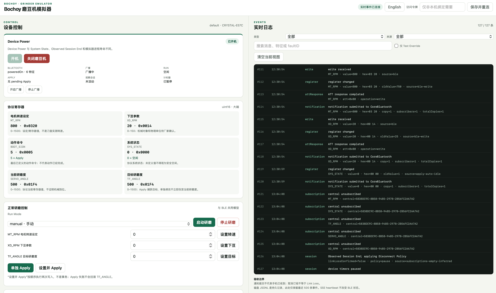

# Bochoy 磨豆机模拟器

**[English](README.en.md)** · 中文（默认）

一个运行在 macOS 上的原生 CRYSTAL BLE GATT 外设模拟器。它通过 CoreBluetooth 广播 `CRYSTAL-E57C`，提供六个协议特征，并在同一进程中提供 CLI、Web 状态监控、设备控制、场景和故障注入。

仓库：<https://github.com/xiaoyu830411/bochoy-grinder-emulator>

当前预发布：[`1.0.0-beta.2`](https://github.com/xiaoyu830411/bochoy-grinder-emulator/releases/tag/v1.0.0-beta.2) · [变更记录](CHANGELOG.md) · [全部 Releases](https://github.com/xiaoyu830411/bochoy-grinder-emulator/releases)

> 本项目用于开发与集成测试，不是真实磨豆机固件，也不模拟机械动作。原始协议见 [`docs/PROTOCOL.md`](docs/PROTOCOL.md)。

## 功能

- **真实 BLE 链路**：使用 macOS `CBPeripheralManager` 发布服务，而不是进程内假 GATT。
- **六个协议寄存器**：固定 2 字节大端 `uint16`，支持读取、带响应写和通知。
- **研磨行为**：manual/timed/smart 启动、停止、目标研磨度和非事务 Apply。
- **同进程 Web 控制台**：左侧控制、右侧实时日志；支持中英双语切换，原始日志保持原文。
- **设备活动**：展示多个 Observed Central、独立观察记录、人工确认断开和全局移出/恢复。
- **可重复测试**：七个内置场景、ATT/通知/延迟故障、显式 Test Override。
- **结构化事件**：终端日志、可选 JSONL、带 sequence ID 和重同步的 SSE。
- **无第三方包**：不使用外部 Swift package、npm 包或前端框架。

## 架构

```text
另一台手机 / 平板                         本机浏览器
nRF Connect / LightBlue / Decaid          控制与实时日志
              │ BLE GATT                         │ HTTP + SSE
              ▼                                  ▼
┌───────────────────────────────────────────────────────────┐
│ bochoy-grinder-emulator（单一进程 / MainActor）           │
│                                                           │
│  CoreBluetooth Peripheral ──→ DeviceModel ←── Web / CLI    │
│                                   │                       │
│                         Scenario / Fault / EventLog        │
└───────────────────────────────────────────────────────────┘
```

Swift 模块：

- `CrystalCore`：协议、设备模型、场景、故障、事件和观察记录。
- `CrystalWeb`：HTTP/SSE、安全策略和 Web 静态资源，不依赖 CoreBluetooth。
- `CrystalSim`：CoreBluetooth 生命周期、CLI、调度及进程装配。
- Web 与 CLI 操作同一个 `DeviceModel`，不会启动第二个模拟设备。

公开产品和可执行文件名为 `bochoy-grinder-emulator`；内部模块名保持 `Crystal*`。为保持本机蓝牙授权身份，Bundle ID 仍为 `local.bocai.crystal-ble-mock`。

## 环境要求

- macOS 13 或更高（构建目标）；实际开发验证环境为 macOS 26.5.2。
- Swift 6.3 或兼容工具链、Xcode 命令行工具。
- Node.js（仅用于前端单元测试，使用内置 `node:test`）。
- Python 3（仅用于 BLE/Web 集成冒烟）。
- macOS 蓝牙权限；真实 BLE 验收需要另一台手机或平板。

构建产物会嵌入 `Resources/Info.plist` 并进行签名。默认使用 ad-hoc 签名：

```bash
bash Scripts/build.sh debug
```

如需稳定签名身份，可设置：

```bash
CODESIGN_IDENTITY="Apple Development" bash Scripts/build.sh release
```

仅在确有需要时重置本模拟器的蓝牙授权：

```bash
tccutil reset Bluetooth local.bocai.crystal-ble-mock
```

## 快速开始

```bash
git clone https://github.com/xiaoyu830411/bochoy-grinder-emulator.git
cd bochoy-grinder-emulator

# Debug 构建与签名
bash Scripts/build.sh debug

# 默认场景，只启动 BLE + CLI
bash Scripts/run.sh

# 启动同进程 Web 控制台，仅监听本机
bash Scripts/run.sh --web 127.0.0.1:8080 --json-log Logs/web-session.jsonl

# 加载指定场景
bash Scripts/run.sh --scenario Scenarios/delayed-apply.json

# 验证蓝牙权限、服务发布和广播后自动退出
bash Scripts/run.sh --permission-probe
```

也可以直接运行已构建的可执行文件：

```bash
.build/debug/bochoy-grinder-emulator --help
.build/debug/bochoy-grinder-emulator --version
# bochoy-grinder-emulator 1.0.0-beta.2
```

启动 CLI 后输入 `help` 查看命令。macOS 蓝牙初始化和广播是异步的；看到 `advertising started` 后再从另一台设备扫描。请求 Web 监听但绑定失败时会输出 `Web listener failed` 并非零退出。

> 同一台 Mac 不能可靠地自广播、自扫描、自连接。HTTP/API 自动化不能替代真实手机 BLE 验收。

## BLE 使用

默认广播名为 `CRYSTAL-E57C`，可通过 `--name CRYSTAL-AB12` 覆盖；后缀必须是四位大写十六进制。

主服务：`7fa2d10c-12f3-4b9e-9d77-1a9b65432100`

| 特征 | 后缀 | 默认值 | 正常写入范围 |
|---|---|---:|---:|
| `MT_RPM` | `...0101` | 0 | 0–1500 |
| `XD_RPM` | `...0102` | 0 | 0–150 |
| `BOOT_SIGN` | `...0103` | 0 | 固件记录 0–10；仅 1–5 有定义 |
| `SYS_STATE` | `...0104` | 0 | 插件不写；0=空闲、1=设备动作中（电机启动或 Apply 调磨） |
| `SERVO_ANGLE` | `...0105` | 830 | 插件不写 |
| `TF_ANGLE` | `...0106` | 0 | 0–1500 |

所有值固定为 **2 字节大端 `uint16`**。base64 只出现在 Decaid 桥日志对照中，不要写入 BLE。

在通用 BLE 工具中选择 **Write Request / Write With Response**：

| 操作 | 特征 | 原始 hex |
|---|---|---|
| 设置目标研磨度 830 | `TF_ANGLE` | `03 3E` |
| 应用目标研磨度 | `BOOT_SIGN` | `00 05` |
| 设置电机值 1200 | `MT_RPM` | `04 B0` |
| 设置下豆值 88 | `XD_RPM` | `00 58` |
| 手动 / 定时 / 智能启动 | `BOOT_SIGN` | `00 01` / `00 02` / `00 03` |
| 停止 | `BOOT_SIGN` | `00 04` |

`TF_ANGLE → BOOT_SIGN=5` 是两次有序写入，不是事务；Apply 失败不会回滚已写入的目标值。ATT 写响应也不表示机械动作完成。写 `5` 后 `SYS_STATE` 变为 `1`；没有活动 Run 时，模拟器按固定的 5 秒 Apply Auto-Idle Timer 把它回 `0`（模拟器兜底规则，不是真机计时保证）。

通用工具检查见 [`docs/IPAD_ACCEPTANCE.md`](docs/IPAD_ACCEPTANCE.md)。

## Web 控制台

不传 `--web` 时不会创建 HTTP 监听。推荐默认只绑定 loopback：

```bash
bash Scripts/run.sh --web 127.0.0.1:8080
# 打开 http://127.0.0.1:8080/
```



绑定非 loopback 地址必须提供非空访问令牌：

```bash
CRYSTAL_WEB_TOKEN='replace-with-a-long-random-token' \
  bash Scripts/run.sh --web 0.0.0.0:8080
```

页面功能：

- 顶栏提供 **中文 / English** 切换。首次默认中文，选择保存在当前浏览器 `localStorage`，刷新后保留；寄存器、设备状态、按钮、反馈和日期随界面切换。原始日志、SSE 和 JSONL 不翻译。
- 桌面左右各占一半并独立滚动；窄屏使用“控制 / 日志”标签页。
- 正常控制：启动、停止、电机转速设定、下豆参数、目标研磨度、Apply。
- 六寄存器卡片显示标题、原始名、十进制、四位 hex 和解释。`MT_RPM` 是设定值而非刀盘实测转速；未定义 BOOT/SYS 值标为“未定义 / Test Override”。
- 设备活动支持多个 central 和多条历史观察记录。绿色=正在订阅，黄色=无订阅或断连未确认，蓝色=仅观察到读写，灰色=人工确认已断开。
- 只有灰色记录可以移出；移出/恢复通过 snapshot/SSE 同步所有浏览器，不删除 JSONL、原始事件或别名，也不影响 BLE。
- 最近 500 条事件支持类型、来源、文本和 Test Override 筛选；JSONL 才是持久记录。
- 高级区域提供场景、故障、session、广播和显式 Override。

Web 不提供模拟器进程退出按钮，也不接受任意路径场景。CLI 和 Web 命令在同一 MainActor 上串行执行，并记录 `source=cli` 或 `source=web`。

Web/实机联合验收见 [`docs/WEB_ACCEPTANCE.md`](docs/WEB_ACCEPTANCE.md)。

## 场景与故障

内置场景位于 [`Scenarios/`](Scenarios/)：

| 场景 | 用途 |
|---|---|
| `default.json` | 正常默认行为 |
| `delayed-apply.json` | Apply 延迟 2 秒 |
| `notification-lab.json` | 响应延迟、通知丢弃与重复 |
| `optional-notify-off.json` | 可选特征订阅失败路径 |
| `required-notify-off.json` | 必需特征订阅失败路径 |
| `smart-manual-finish.json` | 智能启动后等待人工完成 |
| `stop-on-session-end.json` | 推断会话结束时停止研磨 |

场景字段、故障类型和语义见 [`docs/SCENARIOS.md`](docs/SCENARIOS.md)。

CLI 常用命令：

```text
status
set SYS_STATE 2 notify
set SERVO_ANGLE 1000 quiet
notify BOOT_SIGN
fault apply-delay-2000 off
session-end
power off
power on
quit
```

`power off` 关闭的是虚拟磨豆机：取消 Run/Apply、停止广播并移除 GATT，但监控、日志和模拟器进程继续。它不是 Link Loss 证明；`power on` 默认恢复广播。

## 测试

完整本机入口：

```bash
bash Scripts/test.sh
```

它运行 Swift 测试、Node 前端测试、Debug 构建与签名，以及真实 CoreBluetooth 和 HTTP/SSE 集成冒烟。完整测试会启动 BLE peripheral 和独立 HTTP 端口，需要本机蓝牙权限。

也可分别运行：

```bash
swift test
node --test Scripts/web-tests/*.test.js
bash Scripts/build.sh debug
python3 Scripts/smoke_test.py
python3 Scripts/web_smoke_test.py

swift test -c release
bash Scripts/build.sh release
codesign --verify --verbose .build/release/bochoy-grinder-emulator
```

`swift test` 是相对适合 CI 的测试子集；当前仓库没有宣称或伪造 CI 状态。自动化实例使用独立设备名、端口和临时日志，不应操作用户自己的模拟器进程。

## 安全与限制

- CoreBluetooth 没有可靠的单 central connect/disconnect 回调，也没有公开的 per-central 强制断开 API。Disconnect Request 只是 best-effort，断连未确认。
- 通知提交到 CoreBluetooth 不证明手机已收到；取消订阅、session-end 和服务移除不等于 Link Loss。
- 人工确认断开是用户输入，不是系统回调。
- 非 loopback Web 必须配置令牌。Host/Origin 校验和无 CORS 许可不能替代可信网络与令牌保管；不要分享带令牌的 SSE URL。
- 协议没有应用层鉴权、命令序号或防重放机制。BLE STOP 不是紧急停止。
- 未定义状态不得被当成安全空闲；寄存器数值不证明机械位置、刀盘转速或下豆物理单位。
- 本项目不模拟 Decaid HTTP/WebSocket API，不替代 `bochoy-grinder` 的插件内部单元测试。
- 真机日志中的 `bluetoothd unused` 主动断链仍是独立未解决问题；本项目没有用心跳或伪造在线状态掩盖它。

详细边界见 [`docs/ASSUMPTIONS.md`](docs/ASSUMPTIONS.md)。

## 文档

- [`CHANGELOG.md`](CHANGELOG.md)：双语版本变更与预发布说明。
- [`docs/PROTOCOL.md`](docs/PROTOCOL.md)：上游 CRYSTAL BLE 协议快照及来源版本。
- [`CONTEXT.md`](CONTEXT.md)：领域术语。
- [`docs/ASSUMPTIONS.md`](docs/ASSUMPTIONS.md)：模拟假设与平台限制。
- [`docs/SCENARIOS.md`](docs/SCENARIOS.md)：场景和故障格式。
- [`docs/IPAD_ACCEPTANCE.md`](docs/IPAD_ACCEPTANCE.md)：通用 BLE 工具验收。
- [`docs/WEB_ACCEPTANCE.md`](docs/WEB_ACCEPTANCE.md)：Web 与真实 central 验收清单。
- [`AGENTS.md`](AGENTS.md)：中英文 AI agent 开发规范；Claude Code 通过 `CLAUDE.md` 接入同一文件。

## AI 辅助开发

本仓库使用 Claude Code 辅助开发。该说明只适用于 `bochoy-grinder-emulator`，不延伸为上游 `bochoy-grinder`、Decaid 插件、CRYSTAL 固件或协议文档的开发历史，也不表示 Anthropic 对本项目或设备行为的背书。这不改变项目的版权与 Apache-2.0 许可；AI 辅助不替代代码审查、自动化测试或真实设备验收。

使用其他 AI agent 时，不需要复刻 Claude Code 的专属命令：

1. 让 agent 阅读 [`AGENTS.md`](AGENTS.md#中文)，再按其中顺序阅读协议、领域术语和模拟假设；不支持自动读取该文件的工具，可手动将其内容加载为项目指令。
2. 修改前运行基线测试并记录结果；如果已有失败，先区分原因，不要叠加修改。
3. 给 agent 一个边界明确的小任务，要求先写测试并实际观察 Red，再做最小实现达到 Green。
4. 要求保留既有测试、协议语义和安全边界，不擅自增加依赖或操作已有模拟器进程。
5. 完成后运行相关测试和完整 `bash Scripts/test.sh`；报告实际命令、真实结果及未验证项，不把未执行的实机验收写成通过。

可直接复制以下**启动提示词**给任意 AI agent：

```text
请先阅读 `AGENTS.md`、`docs/PROTOCOL.md`、`CONTEXT.md` 和 `docs/ASSUMPTIONS.md`。
先运行基线测试并说明结果。针对我接下来给出的任务，先写会因缺少目标行为而失败的测试；实际观察 Red 后，再做最小实现达到 Green。
不要削弱既有测试，不要虚构浏览器或实机结论。完成后列出实际运行的命令、结果和未验证项；不要自行 commit、push 或操作用户已有进程。
```

完整的中英文规则见 [AGENTS.md](AGENTS.md#中文)。真实 central 验收仍需按 [`docs/WEB_ACCEPTANCE.md`](docs/WEB_ACCEPTANCE.md) 执行。

## 贡献

欢迎 Issue 和 Pull Request：<https://github.com/xiaoyu830411/bochoy-grinder-emulator>

- 保持公开协议行为、内部模块边界和安全语义清晰。
- 所有代码和缺陷修复遵循严格 Red–Green–Refactor：先写测试并实际观察因功能缺失而失败，再写最小实现达到 Green，重构后重跑。
- 不引入未经讨论的第三方依赖。
- 不把 HTTP 成功、通知提交、取消订阅或服务移除写成真实机械/Link Loss 验收结论。

## License

Copyright 2026 xiaoyu830411

本项目使用 [Apache License 2.0](LICENSE)。
